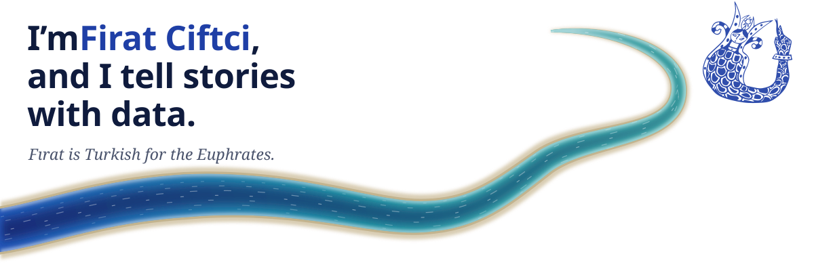

<picture>
  <source media="(prefers-color-scheme: dark)" srcset="river-dark.svg">
  
</picture>

I have built a [record of elections](https://electionsarchive.com) across ten countries and the European Union, dictionaries of Turkish, archives at the [University of Chicago](https://digitalculture.uchicago.edu), and a map of every licensed dog in New York. I live in Brooklyn.

**Down the river**

- [Elections Archive](https://electionsarchive.com), official results for 199,578 elections in ten countries and the European Union, from 1787 to 2026, mapped down to the county, precinct, or neighborhood ([code](https://github.com/electarchive/electionsarchive))
- [Every Dog in New York](https://everydog.nyc), all 96,459 licensed dogs in New York City, by neighborhood ([code](https://github.com/firatciftci/every-dog-in-new-york))
- [Nişanyan Sözlük](https://www.nisanyansozluk.com), the etymological dictionary of Turkish, with its sister sites for [place names](https://www.nisanyanyeradlari.com), [given names](https://www.nisanyanadlar.com), and [the Armenian geography of Turkey](https://www.nisanyanarmenian.com)
- [OCHRE](https://ochre.uchicago.edu) websites at the University of Chicago, among them [Ottoman Inscriptions](https://ochre.uchicago.edu/ottoman-inscriptions) and [Cinemetrics](https://cinemetrics.uchicago.edu)
- [Digital Publication for the Humanities](https://digitalstudies.uchicago.edu/overview/core-courses/), a graduate course I taught twice at the University of Chicago

**Smaller streams**

- [Segue](https://github.com/firatciftci/segue), a macOS menu bar app for switching input sources, with a shortcut for each one and rules that switch for you in each app or website
- [Daybar](https://github.com/firatciftci/daybar), a macOS menu bar app for your calendar and reminders, where you type an event the way you would say it
- [`ochre-sdk`](https://github.com/uchicago-digitalculture-webdev/ochre-sdk), the TypeScript library under the OCHRE websites, downloaded more than 30,000 times last year
- [artsumer.com](https://www.artsumer.com), the website of the .artSümer gallery in Istanbul
- [`@nanostores/svelte-runes`](https://github.com/nanostores/svelte-runes), Svelte 5 runes for Nano Stores
- [`eslint-plugin-inline-utilities`](https://github.com/firatciftci/eslint-plugin-inline-utilities), which keeps utility classes on the element they style
- Fixes upstream in [Knip](https://github.com/webpro-nl/knip), [OpenSeadragon](https://github.com/openseadragon/openseadragon), [svelte-maplibre](https://github.com/dimfeld/svelte-maplibre), [taze](https://github.com/antfu-collective/taze), and [prettier-plugin-tailwindcss](https://github.com/tailwindlabs/prettier-plugin-tailwindcss)

Most of my work lives in private repositories. See more at [firatciftci.com](https://www.firatciftci.com).
